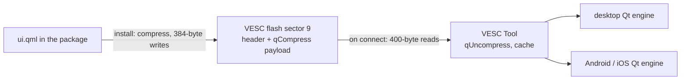

# VESC device QML

A custom VESC GUI is a QML file stored on the controller. VESC Tool reads it over
the link, decompresses it and instantiates it in its own Qt engine. Nothing
renders on the MCU. The same text runs in the desktop app, on Android and on
iPhone, so a package ships one file and every VESC Tool shows it as a tab.

Start here for the workflow. `ref/` holds generated tables of the API a GUI may
call, and `template/` is a working package to copy.

## Quick start

```bash
cp -r <skill>/qml-ui/template ~/my-gui && cd ~/my-gui
make preview     # run ui.qml in a VESC Tool window, no hardware
make             # build template.vescpkg
make compat      # run pkgdesc.qml's isCompatible() against a fake device
```

Install the `.vescpkg` in VESC Tool under **Packages** → **Install from file**,
then reconnect. Remove it with **Uninstall**, which erases the QML flash region.

## How the GUI reaches the screen



1. **Storage.** The controller reserves one 128 KB flash sector for the QML app
   (`CODE_IND_QML`, sector 9 at `0x080A0000`). The sector starts with an 8-byte
   header, and `flash_helper_code_data()` serves the bytes after it:

   | Offset | Size | Contents |
   |---|---|---|
   | 0 | 4 | payload length: flags + compressed data |
   | 4 | 2 | CRC16 over bytes 6 .. 6+length |
   | 6 | 2 | flags: `1` normal tab, `2` fullscreen |
   | 8 | n | `qCompress(script, 9)`, which is a 4-byte size followed by zlib |

   Source: `vesc/flash_helper.c` (`qmlui_check`, `flash_helper_code_data`,
   `flash_helper_code_flags`), layout written by `vesc_tool/codeloader.cpp`
   (`CodeLoader::qmlUpload`, `vesc_tool/codeloader.cpp:746-815`).

2. **Advertisement.** The firmware version reply carries an HW-UI byte and an
   APP-UI byte (`vesc/comm/commands.c:263-287`). Value `2` means fullscreen.
   With no compiled-in app UI the APP byte reports the flags stored in flash, so
   an uploaded GUI makes the device advertise `hasQmlApp` on the next connect.
   VESC Tool parses it into `FW_RX_PARAMS` (`vesc_tool/commands.cpp:145-155`).
3. **Read.** On connect, if the *Load QML UI on connect* setting is on (default),
   the host copies the blob in chunks of at most 400 bytes, 5 tries with a 1.5 s
   timeout each, decompresses it and caches it as `qml_app.bin` in the config
   directory (`vesc_tool/vescinterface.cpp:4116-4250`).
4. **Render.** Each frontend creates the QML object in its own engine: the
   desktop welcome page (`vesc_tool/res/qml/WelcomeQmlPanel.qml:441-467`), the
   mobile main view (`vesc_tool/mobile/main.qml:993-1030`), and the CLI modes
   (`vesc_tool/main.cpp:1650-1715`).
5. **Write.** Install erases the sector, then writes 384-byte chunks with a 1 s
   ack and 5 retries, and reloads the firmware info so the GUI appears without a
   power cycle (`vesc_tool/codeloader.cpp:689-815, 973-1016`).

The commands require firmware 5.03 or newer (`vesc_tool/vescinterface.cpp:3645-3660`).

## Two slots, one of them is yours

| Slot | Who fills it | Where it comes from |
|---|---|---|
| HW UI | board or hardware vendor | compiled into the firmware, `vesc/qmlui/hw/` via `QMLUI_SOURCE_HW` |
| APP UI | an application package | uploaded to flash, or compiled in via `QMLUI_SOURCE_APP` |

A package builds the APP UI. Both slots are fullscreen-capable, and the
fullscreen flag is a property of the installed blob, so changing it means
reinstalling.

## What the host gives your QML

The host prepends two imports before it instantiates the file
(`CodeLoader::qmlCompress`, and the same pair in the `--loadQml` path):

```qml
import Vedder.vesc.vescinterface 1.0;
import "qrc:/mobile";
```

| Name | What it is | Available |
|---|---|---|
| `VescIf` | the one `VescInterface`: connection, configs, files | desktop and mobile |
| `Utility` | theme colours, safe-area insets, blocking helpers | desktop and mobile |
| `Commands` | packet senders and value signals, via `VescIf.commands()` | desktop and mobile |
| `ConfigParams` | one config tree, via `VescIf.mcConfig()` and friends | desktop and mobile |
| `qrc:/mobile` components | `CustomGauge`, `ParamEditors`, `LogBox`, sensors pages, … | desktop and mobile |
| `qmlRegisterType` objects | `BleUart`, `Esp32Flash`, `FwHelper`, `TcpHub`, `LogReader`, `LogWriter`, `CodeLoader`, `QMiniMp3`, `Vesc3dItem`, `SysCmd` | desktop and mobile, but they are VESC Tool internals |
| `QmlUi` | host page object | desktop only, and a different object per page |

Write `VescIf.` and `Utility.` and never `VescIf2` or `Utility2`: the `2` types
exist only so the prepended import parses on desktop (`vesc_tool/main.cpp:1647-1648`).
Do not touch `QmlUi`. On mobile it does not exist, and on desktop it is
`PageWelcome` in one page and `PageScripting` in another.

## Authoring rules

- **Root is one `Item` with `anchors.fill: parent`.** The host injects the file
  with `Qt.createQmlObject()` into a container, so a single root object is
  mandatory and anchoring to the parent is the only sizing that survives both
  layouts.
- **`property string tabTitle`** labels the tab. Without it the tab reads
  `AppUi`.
- **Grab child objects once.** `property Commands mCommands: VescIf.commands()`
  at the top level, not `VescIf.commands().getValues()` inside bindings.
- **Values are signals, not properties.** Call `mCommands.getValues()` from a
  `Timer` (100 ms is the de-facto rate) and read the values in
  `onValuesReceived(values, mask)`.
- **Colours come from `Utility.getAppHexColor(...)`.** Names are
  `lightText`, `normalText`, `normalBackground`, `lightBackground`,
  `darkBackground`, `lightAccent`, `red`, `green`, `yellow`, `cyan`, `blue`, and
  more (`vesc_tool/utility.cpp:50-70`). A hard-coded palette looks wrong on the
  other platform.
- **Stay inside Qt Quick and QtQuick Controls.** No Qt Widgets, no desktop file
  dialogs, no `Qt.labs` modules that might be missing from the phone build.
  `component` inline components need Qt 5.15, which current builds have; skip
  them if you care about older VESC Tool versions.
- **Size the UI for a phone.** The host puts it inside a swipe view next to the
  standard pages, and the mobile app insets its own chrome for the notch. Keep
  controls away from the bottom edge and do not assume a full-screen canvas.
- **One QML file, no bundled assets.** A package carries exactly one `.qml`
  text. Images must come from VESC Tool's own resources, for example
  `"qrc" + Utility.getThemePath() + "icons/Connected-96.png"`.

## Driving the device, not just watching it

The host gives the tab no device-side RPC call. The package pattern (logui,
and the fishi tail tab) is: the UI sends **lisp source** as custom app data,
the device script evaluates it, and replies come back through `send-data`.

```qml
function sendCode(s) { mCommands.sendCustomAppData(s + "\0") }   // NUL-terminate

Connections {
    target: mCommands
    function onCustomAppDataReceived(data) {
        if (data.byteLength === 36 && new DataView(data).getUint8(0) === 1)
            parseTelemetry(data)            // binary frame from the script
        else
            parseReply(data.toString())     // lisp reply string
    }
}
```

```lisp
(defun ev-handler ()
  (loopwhile t
    (recv ((event-data-rx . (? data)) (trap (eval (read data))))
          (_ nil))))
(event-register-handler (spawn ev-handler))
(event-enable 'event-data-rx)
```

- `event-data-rx` is raised by the firmware's app-data handler
  (`commands.c` calls `lispif_process_custom_app_data`), on the ESC and the
  Express alike, once the script enables it. The handler thread is the only
  new thread a command channel needs.
- `send-data` takes a string or a byte array (≤100 B), so one signal carries
  both text replies and binary telemetry. Tell them apart by length and a
  version byte; never by "it looks like text".
- **A GUI command needs its own deadman.** A lisp command is local to the
  controller, so the controller's CAN command timeout does not cover a tool
  that died mid-gait. Have the tab re-send intent at a few Hz and the device
  script disarm on silence (the fishi tail bridge uses 1.5 s; the Express
  companion 2 s). Closing VESC Tool must leave nothing armed.
- **One file, two devices.** To cover two roles with one `ui.qml`, branch on
  `VescIf.getLastFwRxParams().hw` (logui tests `hw.includes("Express")`) and
  keep the device-specific half in each package's `pkgLisp`. Shared QML code
  cannot be split across files, so the roles have to coexist in one file.
- **`pkgLisp` overwrites the device's script.** On a controller that already
  runs one (a native-extension runtime, an existing logger), ship QML only
  and add the command handler to that script instead; installing a package
  with `pkgLisp` replaces it.

## Limits

| Limit | Value | Source |
|---|---|---|
| compressed payload accepted by the tool | 120 KB, with header | `vesc_tool/codeloader.cpp:793` |
| flash payload | 131064 bytes (`128*1024-8`) | `vesc/flash_helper.c:50` |
| transfer chunk, read | 400 bytes | `vesc_tool/vescinterface.cpp:4167` |
| transfer chunk, write | 384 bytes, 5 tries | `vesc_tool/codeloader.cpp:801` |
| read cost per connect | chained packets, 1.5 s timeout each | `vesc_tool/vescinterface.cpp:4116-4250` |

Connect time grows with compressed size. A GUI near the cap makes every connect
slow and can time out over BLE.

## Package descriptor

`pkgdesc.qml` is a QML file whose properties the builder reads
(`createPackageFromDescription`, `vesc_tool/codeloader.cpp:1154-1290`):

| Property | Meaning |
|---|---|
| `pkgName` | name shown in the store and the package page |
| `pkgDescriptionMd` | path to a markdown file; converted to HTML for the listing |
| `pkgLisp` | optional LispBM file, packed with its imports |
| `pkgQml` | the GUI file, the subject of this guide |
| `pkgQmlIsFullscreen` | store as flags `2` instead of `1` |
| `pkgOutput` | output `.vescpkg` path |
| `isCompatible(fwRxParams)` | return false to hide the package for that device |

```bash
vesc_tool --buildPkgFromDesc pkgdesc.qml
vesc_tool --buildPkgFromDesc pkgdesc.qml --testPkgDesc 'vesc:60:'
```

`--testPkgDesc` takes `hwtype:hwname:optfwname` and prints what `isCompatible()`
returns for that synthetic device.

The built file is a `qCompress`ed record stream: string field names, an int32
length, then the payload. Fields are `name`, `description`, `description_md`,
`lispData`, `qmlFile`, `pkgDescQml` and `qmlIsFullscreen` (`CodeLoader::packVescPackage`).
The magic string is `"VESC Packet"`, a typo kept for compatibility.

## Deploy, preview, remove

| Route | Command or screen | Use for |
|---|---|---|
| package | **Packages** → install from file, or the store | normal distribution, desktop and phone |
| direct upload | Scripting page → open the `.qml` → **Upload**, with the fullscreen box | quick iteration |
| compiled in | `qmlui/app/qmlui_example_app.c` + `QMLUI_SOURCE_APP` in `conf_general.h` | board vendors shipping a fixed GUI |

Preview without hardware. `--loadQml` prepends the same two imports plus an
import of the file's own directory, so what you see is what the device will run:

```bash
vesc_tool --loadQml "$PWD/ui.qml"                     # your file
vesc_tool --loadQmlVesc                               # what the device stores
vesc_tool --loadQml "$PWD/ui.qml" --qmlWindowSize 1280:800 --qmlFullscreen
```

Tool options that pair with it: `--qmlAutoConn`, `--qmlFullscreen`,
`--qmlWindowSize width:height`. The default preview window is 1920x1080.

Removal erases the sector: **Packages** → **Uninstall** calls `qmlErase(16)`
(`vesc_tool/pages/pagevescpackage.cpp:394`, `vesc_tool/mobile/Packages.qml:194`).
Reconnecting after that shows no custom tab.

## Traps

- **`TypeError: Cannot call method '...' of null` in preview is expected and
  harmless.** Bindings evaluate once before the context properties are wired,
  then re-evaluate. Verified with a probe: `onCompleted` sees valid objects and
  the values settle. VESC Tool's own `DynamicLoader.qml:50` prints the same
  error during `--loadQml`. The template avoids the noise with `VescIf ? ... : ...`
  and an `appColor()` fallback, which changes no behaviour.
- **The GUI only exists while a tool is connected and loading it.** Nothing runs
  on the controller. A GUI cannot start the motor by itself, and it disappears
  when VESC Tool is closed.
- **An install on a device without the slot fails late.** Install does not check
  `hasQmlApp` when the package contains QML, so a device without the command
  reports an erase timeout instead of a compatibility warning. Gate
  `isCompatible()` if that matters.
- **Fullscreen is stored, not live.** It is the flags field in the blob. Toggle
  it in `pkgdesc.qml` or the upload checkbox and reinstall.
- **Reinstall before you test a change.** The host caches the blob per config
  directory, and a stale cache hides edits until the device re-announces its
  version.
- **Do not poll faster than the link.** Each `getValues()` is a packet, and CAN
  forwarding multiplies it. Ten hertz is fine; per-frame is not.
- **Blocking `Utility` calls freeze the whole app.** `*Blocking` motor detection
  and connection helpers are for VESC Tool's own pages.

## Where the code lives

| Path | Contents |
|---|---|
| `vesc/qmlui/` | compiled-in UI sources, `data_qml_hw` and `data_qml_app` examples |
| `vesc/comm/commands.c` | FW version flags, QML read/erase/write handlers |
| `vesc/flash_helper.c` | sector map, header, CRC check |
| `vesc_tool/codeloader.cpp` | compress, upload, package build and install |
| `vesc_tool/pages/pagescripting.cpp` | scripting page, QML editor and direct upload |
| `vesc_tool/pages/pagevescpackage.cpp` | package build and install UI |
| `vesc_tool/vescinterface.cpp` | connect-time read and cache |
| `vesc_tool/mobile/main.qml` | mobile host, tab creation, fullscreen |
| `vesc_tool/res/qml/` | desktop loaders and the example UIs to copy from |
| `vesc_pkg/` | real packages with a working `ui.qml`: `logui`, `balance`, `crsf` |

## Reference

Generated from a vesc_tool checkout. Do not edit `ref/` by hand.

```bash
python3 gen_qml_refs.py --vesc-tool-root ~/dev/vesc_tool
```

| File | Contents |
|---|---|
| `ref/INDEX.md` | counts, provenance, what is not covered |
| `ref/api-vescinterface.md` | `VescIf` methods and signals |
| `ref/api-utility.md` | `Utility` helpers, theme and colours |
| `ref/api-commands.md` | `Commands` senders, value signals, custom app data |
| `ref/api-configparams.md` | `ConfigParams` get/set by XML name |
| `ref/api-datatypes.md` | value structs such as `FW_RX_PARAMS` and `MC_VALUES` |
| `ref/components.md` | every QML component VESC Tool ships, with its members |

The generator reads `Q_INVOKABLE`, `public slots`, `Q_PROPERTY` and signals from
the headers, plus the qrc file lists for components. It prints the vesc_tool
commit it ran against, so a stale table is obvious.

## Template

`template/` is a minimal package that already follows every rule above:

```
template/ui.qml        values, 10 Hz polling, held-to-drive slider, custom app data
template/pkgdesc.qml   package descriptor, isCompatible() for main-firmware VESCs
template/README.md     description shown in the store
template/Makefile      make, make preview, make compat, make preview-device
```

Copy the directory, rename `pkgName` and `pkgOutput`, then replace the body of
`ui.qml`.
